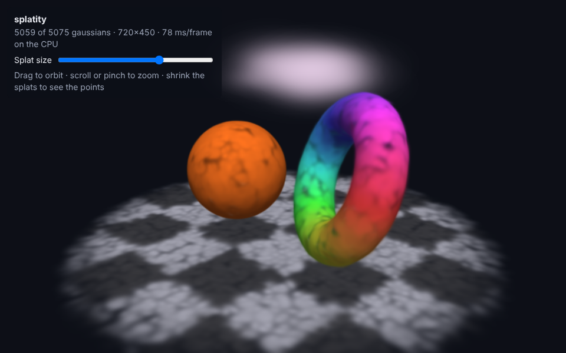
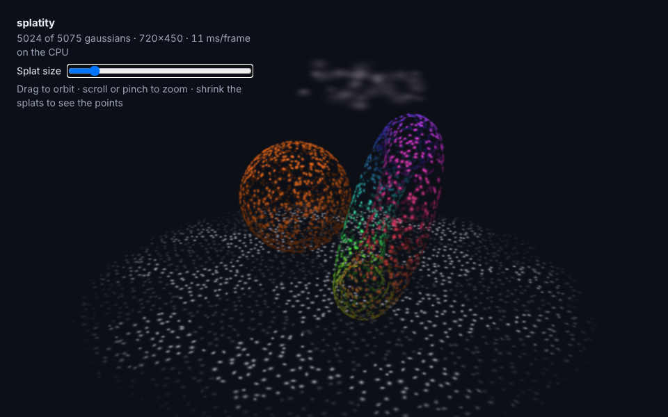

# splatity

A tiny gaussian splatting renderer, written by hand on the CPU to see how the
data actually becomes a picture. In the spirit of
[minity](https://github.com/quosa/minity): no GPU, no libraries, every pixel is
computed in plain TypeScript and put on a canvas.



The same scene with every splat shrunk to a fifth of its size, which shows what
the data really is: a cloud of small, flat, coloured blobs.



## Run it

```bash
npm install
```

```bash
npm run dev
```

Drag to orbit, scroll or pinch to zoom, and use the *Splat size* slider to
shrink the splats. *Open a .splat file* (or drag and drop one) loads a captured
scene.

`npm run check` runs everything CI does: typecheck, lint, unit tests and a
production build. `npm run build` makes a static site in `dist/`, which is
published to GitHub Pages at <https://quosa.github.io/splatity/> on every push
to `main`.

## What a splat scene is

There are no triangles, textures or lights. A scene is just a list of
gaussians, each with five properties (`src/scene.ts`):

| Property   | Meaning                                              |
| ---------- | ---------------------------------------------------- |
| `position` | centre of the blob in 3D                             |
| `scale`    | its size (standard deviation) along three local axes |
| `rotation` | a quaternion orienting those axes                    |
| `color`    | RGB                                                  |
| `opacity`  | how solid it is at its centre                        |

Real scenes are *trained*: an optimiser adjusts millions of these until
renders match a set of photographs. The built-in scene's roughly 5000 splats
are generated in code instead. Surfaces are made of thin pancakes lying flat on the surface;
the fog is made of big, round, nearly transparent blobs.

## Loading captured scenes

Real scenes come from a training run over photographs, and are saved as a list
of gaussians. The viewer reads the `.splat` format (`src/loader.ts`), which is
about as simple as a file can be: no header, just 32 bytes per gaussian holding
the same five properties as the table above.

| Bytes | Content                                               |
| ----- | ----------------------------------------------------- |
| 0-11  | position, 3 x float32                                 |
| 12-23 | scale, 3 x float32                                    |
| 24-27 | red, green, blue, opacity, 4 x uint8                  |
| 28-31 | rotation quaternion (w, x, y, z), 4 x uint8 for -1..1 |

Two object scans of about 280,000 gaussians each that work well are
`plush.splat` and `nike.splat` from
[cakewalk/splat-data](https://huggingface.co/cakewalk/splat-data/tree/main),
the sample data of the [antimatter15/splat](https://github.com/antimatter15/splat)
viewer. No licence is stated for them, so they are not included here.

That is some 55 times more gaussians than the built-in scene, and a full frame
takes a few hundred milliseconds. Two things keep it usable:

- **Preview while moving.** A `.splat` file is stored most important first
  (biggest and most opaque), so the start of the file is a rough version of the
  whole scene. While the camera moves, only as many splats as fit in about
  40 ms are drawn, at half resolution; the full scene is drawn when it stops.
- **Counting sort.** Depth sorting uses 65,536 depth buckets instead of a
  comparison sort.

The same repository has `train.splat`, a locomotive outdoors with about a
million gaussians, which takes around a second per full frame. A scene like
that only looks right from roughly where the photos were taken: orbit too far
out and the camera ends up behind smeared "floater" blobs that no photo ever
constrained. The viewer therefore starts close in when a scene has a far
background, and further back for a lone object.

Captures are rarely level, because nothing in the photos says which way is up.
Shift-drag (or twist with two fingers) to tilt the turntable axis until the
scene sits straight.

## How it is rendered

Everything is in `src/renderer.ts`, and follows the reference rasterizer from
[3D Gaussian Splatting for Real-Time Radiance Field Rendering](https://repo-sam.inria.fr/fungraph/3d-gaussian-splatting/)
(Kerbl et al. 2023).

**0. Covariance (once).** Scale `S` and rotation `R` are combined into a 3x3
covariance matrix `Σ = R·S·Sᵀ·Rᵀ`, which describes the blob as an ellipsoid.

**1. Project.** Each centre goes through the usual perspective projection. The
ellipsoid is flattened to a 2D ellipse with `Σ' = J·W·Σ·Wᵀ·Jᵀ`, where `W` is
the camera rotation and `J` is the Jacobian of the perspective projection at
the splat centre (a local linear approximation, because a gaussian seen
through a true perspective projection is not a gaussian any more).

**2. Sort.** Splats are sorted by depth, nearest first, with a counting sort. A
z-buffer cannot do this job, because blending transparent things depends on
their order.

**3. Blend.** Each splat is drawn into the pixels it covers. For a pixel at
offset `d` from the splat centre:

```
alpha  = opacity · exp(-½ · dᵀ · Σ'⁻¹ · d)
colour += splatColour · alpha · T
T      *= (1 - alpha)
```

`T` is the pixel's transmittance: how much light still gets through
everything drawn so far. It starts at 1, and once it is nearly 0 the pixel is
finished and later splats skip it.

## What is left out

- **Spherical harmonics.** Real splats store colour as SH coefficients so it
  can change with the viewing direction (shiny things). Here each splat has
  one fixed colour with the lighting baked in, which is also all that a
  `.splat` file keeps.
- **Tiles and the GPU.** The reference renderer bins splats into 16x16 pixel
  tiles and runs on the GPU to handle millions of them. This one visits splats
  one by one, so it is limited to a few thousand at a small resolution.
- **Training.** Nothing is learned from photographs.
- **Other file formats.** Only `.splat` is read, not the trainer's own `.ply`
  or compressed formats such as `.spz`.

## Conventions

Right-handed world with +Y up, as in minity. Camera space is x right, y up and
z the distance in front of the camera. Screen coordinates start top-left.
Matrices are row-major.
